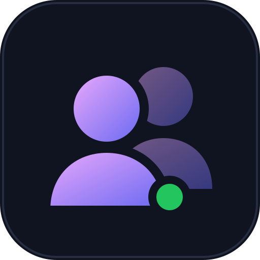

<p align="center"></p>

# herdr-claude-accounts

A Herdr.app sidebar mod to **switch between Claude accounts**. Each account is a separate profile folder (`CLAUDE_CONFIG_DIR`).

- Initial avatar, name and email per account; the active one has a green dot.
- **new agent** opens a Claude agent in that account; **sign in** / **+ add account** start `claude auth login` first.
- **sign out** and **remove** (both ask to confirm). Remove signs the profile out and forgets it; the folder stays on disk. The main profile can't be removed.

## The Claude mods

Each one works on its own; together they share the account list.

| Repository | What it does |
| --- | --- |
| [herdr-claude-context](https://github.com/gabriel-mend/herdr-claude-context) | Context-window usage per agent, with a compact button |
| [herdr-claude-plan-usage](https://github.com/gabriel-mend/herdr-claude-plan-usage) | Claude 5h / 7d plan rate-limit usage |
| [herdr-claude-accounts](https://github.com/gabriel-mend/herdr-claude-accounts) (this one) | Switch between Claude accounts |

## Easy install (all 3 mods)

Needs Herdr.app, Claude Code, `git` and `python3`. Paste into a terminal; running it again updates the mods.

```sh
(
set -e
MODS="$HOME/.config/herdr-app/mods"
mkdir -p "$MODS" "$HOME/.claude/hooks"
for m in claude-context claude-plan-usage claude-accounts; do
  if [ -d "$MODS/$m/.git" ]; then git -C "$MODS/$m" pull --ff-only
  elif [ -e "$MODS/$m" ]; then echo "skipped $m: $MODS/$m exists and is not a git clone"
  else git clone "https://github.com/gabriel-mend/herdr-$m" "$MODS/$m"
  fi
done
cp "$MODS/claude-plan-usage/claude-hook/herdr-usage-statusline.py" "$HOME/.claude/hooks/"
python3 - <<'PY'
import json, os
p = os.path.expanduser("~/.claude/settings.json")
s = json.load(open(p)) if os.path.exists(p) else {}
if "statusLine" in s:
    print("statusLine already set: left unchanged (see herdr-claude-plan-usage)")
else:
    s["statusLine"] = {"type": "command", "command": "python3 ~/.claude/hooks/herdr-usage-statusline.py"}
    json.dump(s, open(p, "w"), indent=2)
    print("statusLine added")
PY
)
```

Then add the blocks to a personal layout. Shipped layouts are read-only, so clone one first (`layout.clone`; run `herdr-app commands` for its arguments). Put these inside the sidebar column of your file in `~/.config/herdr-app/layouts/`:

```json
{ "id": "claude-context",    "type": "block", "size": { "weight": 1 }, "min": 90, "content": { "mod": "claude-context" } },
{ "id": "claude-accounts",   "type": "block", "size": { "px": 150 },  "min": 60, "content": { "mod": "claude-accounts" } },
{ "id": "claude-plan-usage", "type": "block", "size": { "px": 78 },   "min": 60, "content": { "mod": "claude-plan-usage" } }
```

Switch to it with `herdr-app do layout.switch --name <your-layout>`. Changing to a layout without these blocks hides the mods.

## Install only this mod

```sh
git clone https://github.com/gabriel-mend/herdr-claude-accounts ~/.config/herdr-app/mods/claude-accounts
herdr-app check ~/.config/herdr-app/mods/claude-accounts
```

Add it as a block in a personal layout:

```json
{ "id": "claude-accounts", "type": "block", "size": { "px": 150 }, "min": 60, "content": { "mod": "claude-accounts" } }
```

## Active account in the top bar (optional)

The same mod can show the active account (avatar and email) next to the tabs: add a second block with `"props": { "badge": true }`. In your personal layout, replace the `tabs` block with a row that holds both (keep your own `tabs` settings and move its `size` to the row):

```json
{ "id": "topbar", "type": "row", "size": { "px": 42 }, "resizable": false, "children": [
  { "id": "tabs", "type": "block", "content": { "mod": "tabs" }, "size": { "weight": 1 }, "window_drag": true },
  { "id": "active-account", "type": "block", "content": { "mod": "claude-accounts", "props": { "badge": true } }, "size": { "px": 240 }, "window_drag": true }
] }
```

It shows the account selected in this mod; agents already running keep the account they started with.

## Notes

- Profiles are stored in `~/.claude/state/herdr-accounts.json`; [herdr-claude-context](https://github.com/gabriel-mend/herdr-claude-context) and [herdr-claude-plan-usage](https://github.com/gabriel-mend/herdr-claude-plan-usage) read it.
- New profiles start empty (no history, `CLAUDE.md`, MCP servers or skills of the main profile) and get the plan-usage `statusLine` automatically.
- Agents started in a plain terminal use the main profile. Signing out of the main account breaks its already-open agents.

## Author

<a href="https://www.linkedin.com/in/gabriel-mendonca-pereira/"></a>

**[Gabriel Mendonça Pereira](https://www.linkedin.com/in/gabriel-mendonca-pereira/)**

## License

[MIT](LICENSE) © 2026 [Gabriel Mendonça Pereira](https://github.com/gabriel-mend) · [LinkedIn](https://www.linkedin.com/in/gabriel-mendonca-pereira/)
